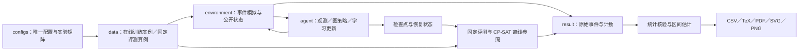

# 情景辅助竞争感知图强化学习：柔性流水车间调度

本仓库研究动态订单到达下的柔性流水车间调度，包含环境、图强化学习方法、学习与规则对照，以及从训练到论文表图的可追溯实验管线。

**第一轮正式研究（50 个参数算例、73 个训练作业、6,400 万交互）已完成并发布在 `result/formal/`**（标签 `paper2-v1-formal`，分析见 [正式实验结果分析](docs/results-analysis.md)）。两项核心机制在饱和的固定网格上未识别出条件增益，因此方法与基准按 [预注册 v2](docs/preregistration-v2.md) 重设计：主基准改为争用网格（102 例固定数据，旧 50 例不变），先运行预注册试点（18 作业、900 万交互）、通过门槛后再启动正式 v2（73 作业、6,400 万交互，`result/formal2/`）。工程冒烟用于检查实现，不用于选择参数或证明方法胜出；上一轮本机验收见 [验收报告](docs/ACCEPTANCE.md)，新代码需重新自检。

## 1. 先理解问题与方法

订单动态到达，每个产品按固定阶段顺序加工；各阶段有并行机器，并非所有机器都具备加工每道工序的资格。加工不可抢占。只有整个订单按时完成才获得等权履约收益；等待中的无望订单被放弃，已消耗的加工能力不返还。

在线策略只读取公开加工目录、已到达订单和可见历史。动作是所有合法的 `Dispatch(order, machine)` 与“等机”`Wait`（只有当某就绪订单等一台即将释放的忙碌机器能比派到任一空闲机器更早完工时才可等待，唤醒于下一事件），不裁剪派工候选。未来实际订单对策略不可见。

主方法 `full` 包含三个部分（v2）：

- **图策略与机器争用者注意力修正**：HGNN 编码订单、工序和机器；对每个候选派工，聚合在其占用窗口内竞争同一机器或被该承诺推迟的其他订单（逐候选归一化，尺度不变），门控以争用者数量为条件，零初始化读出，无争用者的候选保持基础分数。
- **争用状态上的成对策略改进**：训练时只在“候选承诺会改变哪些订单迟交”的状态发查询：锚点为当前策略贪心动作，挑战者为策略次优或教师规则动作；两分支共享未来并由冻结策略延续，未来逐个加入直到差异符号确定；只有挑战者可靠胜出的标签才以交叉熵改进策略。在线推理不运行情景搜索或规则教师。
- **示范初始化**：教师规则在争用验证集上预注册择优（本轮为 SPT，见 `data/instances/fixed2/teacher.json`），完成监督初始化后继续强化学习。

到达频率为 `iota = lambda × p_bar`，系统负荷为 `rho = lambda × u_star`。本研究以 `iota ≥ 1` 定义高频；同一目录下频率与负荷联动，不能解释为两个独立控制因素。

## 2. 代码与数据如何流动



| 模块 | 职责 | 建议阅读入口 |
|---|---|---|
| `configs/` | 配置、方法集合、试点/正式作业矩阵、教师择优与身份规则 | [experiment.yaml](configs/experiment.yaml)、[experiment.py](configs/experiment.py) |
| `data/` | 在线随机生成、固定网格与用途映射 | [online.py](data/online.py)、[benchmark.py](data/benchmark.py) |
| `environment/` | 合法动作、事件推进、公开信息隔离、离线排程 | [public.py](environment/public.py)、[env.py](environment/env.py) |
| `agent/` | 图观测、策略、PPO/Q-learning、情景偏好与恢复 | [model.py](agent/model.py)、[training.py](agent/training.py)、[preference.py](agent/preference.py) |
| `result/` | 记录、身份、评测、统计、图表及验收 | [recording.py](result/recording.py)、[evaluation.py](result/evaluation.py) |
| `scripts/` | 按依赖执行各阶段，管理进程池、试点裁决和验收 | [pipeline.py](scripts/pipeline.py)、[run_pilot.py](scripts/run_pilot.py) |
| `tests/` | 机制、完整性、故障恢复及多进程回归 | [test_acceptance.py](tests/test_acceptance.py) |

复现实验可直接从下一节开始；理解实现可按 `public → observation → model → training → evaluation` 阅读。字段和预算口径见 [数据字典](docs/data-dictionary.md)。

## 3. 安装与完整自检

在仓库根目录打开 PowerShell。本机使用以下解释器；其他机器可将 `$Python` 换成安装依赖的 Python 路径。

```powershell
$Python = 'E:\anaconda3\envs\python3.13\python.exe'
& $Python -m pip install -r requirements.txt
& $Python scripts/run_00_smoke.py 8
```

依赖下限见 [requirements.txt](requirements.txt)，实测版本保存在各运行目录的 `runtime.json`。本机 Python 为 3.13；代码使用 CPU，不会因安装了 CUDA 版 PyTorch 而自动切换 GPU。Linux 可使用 `python scripts/run_00_smoke.py 8`；当前本轮验收环境为 Windows，其他平台需重新自检。

完整自检包括全部回归测试、17 个微型训练作业、真实并行与串行结果比对、评测、离线回放、统计和图表，并检查教师择优与有效的改进动作更新（情景探针从未初始化策略出发，使规则挑战者可靠胜出）。另在独立进程中使用正式网络、批量、完整缓冲容量和最大车间输入进行资源探针。因此它比单独运行 `pytest` 更完整，也比旧版仅微型冒烟更耗时。

```powershell
# 只运行回归测试；不能替代完整冒烟
& $Python -B -X utf8 -m pytest tests -q
```

成功时出现 `[OK] Engineering acceptance`，且 `result/engineering/complete.json` 指向本轮目录。目录内保存 `pytest.xml`、微型作业、`probes/parallel.json`、`probes/resources.json` 和表图。源码、环境及并发覆盖匹配时，重复命令核验文件后复用结果，不新增模拟交互；请求更高并发时会补做验收。

工程交互**没有累计硬上限**，但仍记录实际消耗和未确认预留。旧账本原样保存在 `result/engineering/accounting/legacy.json`，新进程分别写入 `accounting/sessions/`，汇总写入 `interaction_ledger.json`。这些记录与正式作业预算分开，故障和重试也不隐去。

## 4. 实验的组成（v2）

训练在线生成 3 产品、3 阶段、每阶段 2 台机器、32–96 订单的实例；70% 来自争用 regime（目标负荷 ρ∈[0.9,1.8]、交期系数 κ∈[1.4,2.2]），其余来自旧的三个 regime。固定评测算例由方法和训练种子共享。

| 固定用途 | 规模 | 唯一算例数 |
|---|---|---:|
| 争用测试（主基准） | 标准车间，ρ∈{1.0,1.3,1.6} × κ∈{1.5,2.0} × 48／96 订单 × 3 个独立实例 | 36 |
| 争用验证（监控、验证最优、教师择优） | 标准车间，72 订单，ρ∈{1.15,1.45}，κ=1.75，2 例 | 4 |
| 争用离线参照 | 标准车间，24／36 订单，ρ=1.3，κ∈{1.5,2.0}，3 例 | 12 |
| 旧验证 | 标准车间，72 订单 | 6 |
| 旧主测试 | 标准车间，48／96 订单 | 12 |
| 旧小规模离线参照 | 标准车间，12／24 订单 | 12 |
| 长到达流 | 标准车间，128／192 订单 | 12 |
| 大车间 | 6 产品、5／7 阶段、每阶段 3 台机器 | 8 |
| 敏感性 | 引用争用测试文件 | 0 |

争用单元按目标负荷参数化并反算到达强度；旧网格为 `iota={0.6,1.5,2.5}`、交期系数 `{1.5,3.0}`，大车间只用两档高频。目录要求整组负荷均在 `[0.3,1.8]`，这是联合条件采样。种子、子流、目录及文件身份保存在固定数据的 manifest 中。

| 研究 | 训练组 | 配置与种子 | 每作业预算 | 合计 |
|---|---|---|---:|---:|
| 预注册试点 | 主方法与关键对照 | `full`、`no_graph`、`no_scenario`、`no_demo`、`hgnn`、`ppo`，各 3 种子 | 50 万 | 900 万 |
| 正式 v2 | 主方法 | `full`，5 种子 | 100 万 | 500 万 |
| 正式 v2 | 学习对照与消融 | 10 方法，各 5 种子 | 100 万 | 5,000 万 |
| 正式 v2 | 敏感性 | 6 个单因素变化，各 3 种子 | 50 万 | 900 万 |

学习对照为 DQN、DDQN、A2C、PPO、HGNN、双注意力；消融为 `no_graph`、`no_scenario`、`no_demo`、`impact_only`。敏感性改变最大未来数、可靠性阈值或辅助权重，默认配置复用主方法对应检查点。试点的假设、门槛与裁决规则见 [预注册 v2](docs/preregistration-v2.md)；完整清单见 [运行矩阵](docs/run-matrix.md)。

SPT、FCFS、EDD、MST、CR、LWKR 无需训练；额外保留 SPT-mixed 平局变体。CP-SAT 拥有未来信息，作为离线参照，只有 `OPTIMAL` 表示已证明最优。

## 5. 按阶段启动与检查

先完成自检。下表命令均在仓库根目录执行；`$Python` 沿用上一节。训练命令末尾可带一个正整数并发数。

| 阶段 | 命令 | 前置条件与完成产物 |
|---|---|---|
| 准备 | `& $Python scripts/run_01_prepare_data.py` | 校验 102 例并记录教师择优，生成正式 freeze、matrix 和零用量账本 |
| 试点 | `& $Python scripts/run_pilot.py 1` | 冒烟通过；18 作业、评测、离线参照、统计、导出与 `result/pilot/pilot_verdict.json` |
| 主方法 | `& $Python scripts/run_02_train_main.py 1` | 当前源码冒烟通过；5 个作业完成 |
| 对照与消融 | `& $Python scripts/run_03_train_comparators.py 1` | 50 个作业完成 |
| 敏感性 | `& $Python scripts/run_04_train_sensitivity.py 1` | 18 个作业完成 |
| 评测 | `& $Python scripts/run_05_evaluate.py` | 全部训练完成；生成各用途评测和共享状态延迟 |
| 离线参照 | `& $Python scripts/run_06_exact_reference.py` | 数据完成；24 个小规模求解（旧 12 + 争用 12）与排程回放 |
| 统计 | `& $Python scripts/run_07_statistics.py` | 评测与离线参照完整；生成效应、区间及轨迹审计 |
| 导出 | `& $Python scripts/run_08_export.py` | 统计完整；生成 `paper_assets/manifest.json` 及资产 |

也可由一个入口依次执行以上阶段：

```powershell
# 会真正启动全部 6,400 万训练交互；本次工程验收不执行此命令
& $Python scripts/run_formal_all.py 1
```

示例使用单作业，增加并发前应参考最新 [资源验收](docs/ACCEPTANCE.md)。不带参数时默认并发上限为 `runtime.jobs=8`，上限还受逻辑核心数约束；正式启动前会检查当前可用内存和磁盘，资源不足会明确退出。不会通过缩小网络、批量或记录粒度来继续运行。

需要区分三个概念：

- **作业并发数**：独立方法／种子进程的数量，每进程默认 1 个 PyTorch 线程。
- **训练环境数**：一个作业内收集样本的 8 个环境，不等于额外启动 8 个操作系统进程。
- **统计重复数**：训练种子产生独立训练重复；同状态计时重复和固定参数单元不能代替训练种子。

数据准备、统计和导出串行；在线延迟在共同的 SPT 状态面板上串行测量，正式预热 10 次、计时 30 次。小规模 CP-SAT 每例单线程，墙钟上限 1800 秒、确定性时间 300；24 例求解上限合计约 12 小时（旧 12 例通常数秒内证明最优），另有构模与回放。

PyCharm 中选择相同解释器、对应脚本及仓库根目录作为工作目录；Parameters 留空或填一个并发数即可。

## 6. 保存、失败与恢复

每个作业位于 `<根目录>/runs/<方法>_s<种子>/`（试点 `result/pilot/`，正式 v2 `result/formal2/`，第一轮 `result/formal/`），包含独立 `stdout.log`、`status.json`、`budget.json`、检查点和 `raw/`。

正式 `total_steps = real_steps + scenario_steps + demonstration_steps + lost_upper_bound`。验证评测另记成本。崩溃时无法确认的预留按上界计费，不额外赠送预算。

`checkpoint_last.pt` 与 `checkpoint_previous.pt` 保存恢复状态；固定里程碑、初始化及验证最优模型另存。完成作业的 `completion_manifest.json` 校验文件内容，恢复检查点、预算提交和原始记录必须相互一致。按原命令重跑即可恢复或复用。

| 现象 | 检查与处理 |
|---|---|
| 作业失败 | 查看对应 `stdout.log`、`status.json` 和 `budget.json`；修复原因后重跑原命令 |
| 目录已被占用 | 活进程或其他主机的锁会被拒绝；同主机已退出进程的残留锁可自动归档恢复 |
| 源码／配置／数据不兼容 | 拒绝沿旧运行续训；不要改身份值、删除账本或重抽固定算例来绕过检查 |
| 文件损坏或资产缺失 | 明确报错，保留证据；不会凭完成标记直接通过验收 |
| 内存／磁盘不足 | 查看 `memory_preflight.json`／`storage_estimate.json`，降低作业并发或提供存储空间 |
| 一个并行作业失败 | 停止提交后续任务，其余作业在持久化检查点边界退出；整批非零返回 |

源码包、有效配置、运行环境和哈希随作业保存。文本身份归一化 CRLF/LF；二进制文件按原字节校验。训练语义改变拒绝旧检查点续训；报告修改不改变训练身份。大型产物在 Git 中忽略，本地保留。

## 7. 从哪里读取结果

| 需要的证据 | 主要文件 |
|---|---|
| 主比较、消融、泛化 | `contested.csv`、`main.csv`、`long_stream.csv`、`large_shop.csv`、`summary.csv`、`effects.csv`、`case_effects.csv`、`cell_effects.csv` |
| 敏感性、初始化、学习过程 | `sensitivity.csv`、`initialization.csv`、`contested_*.csv`、`learning_curves.csv` |
| 原始决策与可追溯性 | `runs/*/raw/`、`evaluations/*/`、`trace_audit.csv`、各 manifest |
| 离线参照 | `exact.csv`、`exact_schedule.csv`、`exact/*.json`、`offline_gaps.csv` |
| 运行与行为 | `costs.csv`、`execution/*.json`、`latency.csv`、`behavior.csv`、`preference_diagnostics.csv` |
| 可用于写作的表图 | `paper_assets/` 内的 CSV、TeX、PDF、SVG、PNG 和来源 manifest |

上述路径相对研究根目录（`result/pilot/`、`result/formal2/`；第一轮为 `result/formal/`，见 [结果目录说明](result/README.md)）；工程自检有相同结构，但资产标注“Engineering smoke only”。作业耗时之和、并行批次墙钟和单次推理延迟是不同指标。

主证据为整体重采样训练种子向量得到的自助 95% 区间和逐算例／逐设计单元配对效应。配对 Wilcoxon 原始 p 值仅作附录参考，不做多重比较校正。争用网格每个参数组合 3 个独立实例、旧网格 1 个，都不能将固定网格均值解释为该参数下随机实例总体的期望。负结果完整保留，导出不要求主方法胜出。

进一步阅读：[预注册 v2](docs/preregistration-v2.md) · [实验规格](docs/experiment-spec.md) · [数据字典](docs/data-dictionary.md) · [主张与证据映射](docs/claim-evidence.md) · [验收报告](docs/ACCEPTANCE.md) · [正式实验结果分析](docs/results-analysis.md)（2026‑10‑13，基于已发布的 `result/formal/`）· [结果目录说明](result/README.md)。
